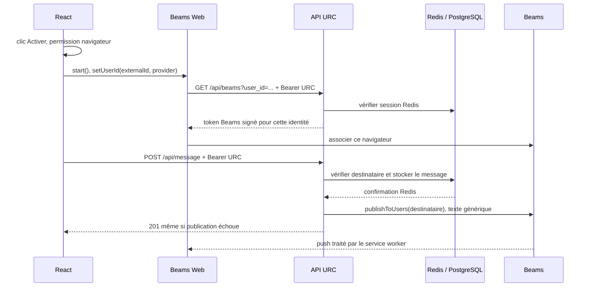

# Étape 10 — Notifications Web Push avec Pusher Beams

## Architecture et décisions

Les dépendances déjà installées sont conservées : Web SDK 1.1.0 et Node SDK 1.2.7. Aucune installation, modification de secret, migration SQL, modification des sessions, modification de la politique Redis ou mise en production n’a été effectuée.

Documentation officielle consultée avant l’implémentation : [SDK Web](https://pusher.com/docs/beams/reference/web/), [SDK Node](https://pusher.com/docs/beams/reference/server-sdk-node/), [réception dans le service worker](https://pusher.com/docs/beams/guides/handle-incoming-notifications/web/). Les signatures ont aussi été vérifiées dans les sources des versions installées.



Le **service worker** est un script que le navigateur exécute hors de la page. Il peut afficher une notification lorsque l’onglet est fermé, selon les restrictions du navigateur et du système. Il ne contient aucun secret ni token URC.

Le **polling** existant récupère les messages en interrogeant URC toutes les huit secondes lorsqu’une conversation est ouverte. Le **Web Push** signale un événement via le navigateur ; il ne transporte pas l’historique. Le polling reste inchangé et fonctionne même lorsque Push est désactivé ou indisponible.

**Beams** gère les appareils et la livraison des notifications. Le backend URC reste responsable de l’authentification, du destinataire et du stockage. **setUserId** associe le navigateur à l’`externalId` stable du compte ; le SDK doit obtenir une signature de notre serveur avant de réaliser cette association.

Le **token URC** est le Bearer existant vérifié dans Redis. Le **token Beams**, signé côté serveur, sert uniquement à l’association d’un appareil chez Pusher. Il n’accorde aucun accès aux conversations URC. Les deux tokens restent hors de Redux, du DOM et des logs applicatifs. La clé secrète ne quitte jamais le backend.

## Fichiers créés et modifiés

- `lib/beams.js` — Créé : configuration serveur paresseuse et publication privée isolée des erreurs de stockage.
- `src/features/notifications/pushController.ts` — Créé : permissions, association SDK, sérialisation des opérations et annulation des activations obsolètes.
- `src/features/notifications/usePushNotifications.ts` — Créé : configuration publique Vite, abonnement à Redux et hooks React.
- `src/features/notifications/NotificationControls.tsx` — Créé : état et boutons accessibles, sans bibliothèque UI.
- `scripts/notifications-browser.mjs` — Créé : parcours Firefox reproductible avec SDK/API simulés.
- `docs/etape-10-notifications.md` — Créé : présent livrable pédagogique.
- `api/beams.js` — Modifié : identité validée via Redis, contrôle user_id, GET, réponses sûres et configuration absente.
- `api/message.js` — Modifié : lecture external_id du destinataire et publication après confirmation Redis.
- `public/service-worker.js` — Modifié : suppression du log du payload, affichage générique et clic limité à une route interne.
- `src/features/auth/AuthInitializer.tsx` — Modifié : branchement global du nettoyage Beams, indépendant de la page affichée.
- `src/pages/MessagesPage.tsx` — Modifié : affichage du panneau de notifications.
- `src/routes/ProtectedRoute.tsx` — Modifié : mémorisation de la route demandée dans le state du redirect login.
- `src/user/Login.tsx` — Modifié : reprise uniquement d’une destination privée autorisée après connexion.
- `scripts/auth.test.cjs` — Modifié : mocks SDK/env, tests supplémentaires et adaptation du rendu React simulé.
- `scripts/vercel-packaging.test.cjs` — Modifié : inclusion de /api/beams, démarrage isolé et signature réelle du SDK sans réseau.

## Permissions et cycle de vie

Le bouton « Activer les notifications » est la seule entrée qui appelle `Notification.requestPermission()`. L’appel est effectué immédiatement dans le geste utilisateur, avant une attente réseau, notamment pour Firefox. Une permission déjà accordée n’est pas redemandée. Un refus masque le bouton Activer et invite à modifier les paramètres du navigateur. Une fermeture du dialogue laisse les notifications désactivées ; une exception est traitée comme une erreur.

Le contrôleur est partagé entre les pages, avec `useSyncExternalStore` pour l’interface. L’abonnement global à Redux suit l’identité authentifiée. Aucune nouvelle propriété n’est ajoutée au store. Les opérations SDK sont exécutées en série ; une génération invalide les résultats d’une activation commencée pour un ancien compte. Le provider relit le token URC au moment de la demande et ignore une réponse obsolète après remplacement de ce token.

`stop()` est utilisé pour désactiver et nettoyer l’appareil local et distant. Dans le SDK installé, `clearAllState()` appelle ensuite `start()` ; ce comportement serait inutile pour une désactivation et pourrait redemander une permission. Un nettoyage échoué affiche une erreur et doit réussir avant l’association d’un autre compte. Aucun échec brut du SDK n’est journalisé.

Au rafraîchissement, la restauration URC existante termine d’abord sa vérification. Le contrôleur peut reconnaître une association SDK déjà présente pour ce même utilisateur avec permission accordée, sans `start()`, `setUserId()` ou demande automatique de permission. Une association d’un autre utilisateur est nettoyée. Une réponse 401 à la demande de token Beams invalide uniquement la session courante, puis déclenche le nettoyage.

États affichés : configuration absente, navigateur incompatible, désactivé, activé, refusé, traitement en cours et erreur. Le serveur distingue une configuration absente d’une panne ; la messagerie reste utilisable dans les deux cas.

## Publication privée et sécurité

La requête PostgreSQL lit l’`external_id` du destinataire, identifié par son identifiant numérique validé. Le `senderId` vient de la session, jamais du corps client. Après confirmation de `storeMessage`, une seule invocation nominale de `publishToUsers` vise cet `external_id`. Le payload contient uniquement un titre, un texte générique et `/messages/user/<id-expéditeur>`. Aucun contenu du message, mot de passe, token, nom d’utilisateur ou URL fourni par le client n’est transmis.

La publication est un effet secondaire : après stockage confirmé, un rejet Pusher produit un avertissement fixe et la réponse reste HTTP 201. L’attente est bornée à trois secondes, sans nouvelle tentative. Le SDK Node installé n’expose pas de délai d’expiration configurable : la requête sous-jacente peut encore se terminer après cette limite. Le message est déjà dans Redis ; présenter l’envoi comme échoué risquerait de provoquer un doublon lors d’un renvoi manuel.

Le service worker conserve le handler d’affichage officiel et remplace les champs affichés par des valeurs génériques. Son handler de clic est enregistré avant celui du SDK : il bloque le traitement par défaut pour une notification Beams et n’ouvre qu’une route privée numérique valide sur la même origine. Toute autre destination retombe sur `/messages`. Le `deep_link` arbitraire est ignoré. La route passe toujours par la restauration de session et `ProtectedRoute`. Après login, seule une destination `/messages/user/<id>` valide peut être reprise ; les autres valeurs conduisent à `/messages`.

Les messages privés ne doivent pas apparaître sur un écran verrouillé ou être transmis inutilement au fournisseur de notifications. L’utilisateur doit ouvrir une conversation authentifiée pour les lire.

Les salons n’appellent pas cette publication. Une étape ultérieure devra définir des abonnements explicites ou une vraie appartenance aux salons et les préférences des utilisateurs avant de décider des destinataires.

## Configuration manuelle nécessaire

L’inspection du `.env` local n’a affiché que la présence des noms de paramètres. Les trois paramètres suivants sont absents ou vides dans ce fichier ; aucune valeur n’a été changée et les paramètres du tableau de bord Vercel n’ont pas été inspectés.

| Paramètre | Emplacement | Rôle |
| --- | --- | --- |
| `PUSHER_INSTANCE_ID` | Serveur Vercel / environnement local serveur | Instance Beams |
| `PUSHER_SECRET_KEY` | Serveur uniquement | Signature des tokens et publication |
| `VITE_PUSHER_INSTANCE_ID` | Configuration publique du build Vite | Même Instance ID que le serveur |

Configurer manuellement une instance Beams Web depuis le tableau de bord Pusher en suivant sa documentation, puis renseigner ces paramètres dans les environnements appropriés. Ne jamais préfixer la clé secrète par `VITE_`. Vite incorpore les variables publiques à la compilation : un futur build sera nécessaire après leur ajout. Cette intervention n’effectue aucun déploiement.

Le navigateur doit être compatible avec Notifications, PushManager, IndexedDB et Service Workers, avec un contexte sécurisé HTTPS ou localhost. Le worker est servi à `/service-worker.js`, de portée racine ; `public/` est copié à la racine par Vite. La règle SPA Vercel existante exclut les fichiers avec extension et ne réécrit donc pas ce fichier vers `index.html`. Les fonctions utilisent le runtime Node existant, compatible avec le SDK serveur.

## Vérifications exécutées

Toutes les bases et tous les services des parcours automatisés sont simulés, sauf le code des bibliothèques, la compilation, le moteur Firefox et l’empaquetage eux-mêmes.

| Commande / contrôle | Résultat |
| --- | --- |
| `node scripts/auth.test.cjs` | 322 tests réussis : 292 existants conservés et 30 nouveaux |
| `node scripts/vercel-packaging.test.cjs` | 7 tests réussis, incluant les 6 précédents et Beams |
| TypeScript `tsconfig.app.json`, `--noEmit --incremental false` | Réussi |
| TypeScript `tsconfig.node.json`, `--noEmit --incremental false` | Réussi |
| `node scripts/notifications-browser.mjs` | Parcours Firefox avec SDK/API simulés réussi |
| Build Vite réel, sans `.env`, dans un répertoire temporaire | Réussi ; copie exacte du service worker vérifiée |
| `git diff --check` | Réussi |

Les tests Node couvrent les sessions valides, absentes, expirées, l’usurpation d’identité Beams, la configuration manquante, les réponses sûres, les permissions accordées/refusées/fermées/en erreur, les navigateurs incompatibles, l’activation/désactivation, le changement de compte, la déconnexion, une activation obsolète et un nettoyage échoué. Ils vérifient aussi la publication après stockage, le bon destinataire, l’absence d’envoi à l’expéditeur, de texte privé ou de champs client malveillants, la panne et la lenteur Pusher sans perte de la réponse 201, l’absence de publication après panne Redis, en lecture ou pour les groupes. Le service worker est exécuté dans un contexte simulé pour tester son affichage et ses destinations autorisées/interdites ; les tests de polling précédents restent conservés.

Le test d’empaquetage construit de vrais artefacts Vercel dans `/tmp`, les charge en isolation, vérifie une réponse 401 sans session et génère/vérifie un JWT avec le vrai SDK Beams et une clé synthétique. Aucune connexion à Pusher n’est nécessaire.

Le parcours Firefox vérifie la destination protégée et reprise après login, l’absence de demande automatique, l’activation par clic avec Bearer, la conservation sans rechargement, la restauration d’une association simulée après rafraîchissement, la désactivation, le refus, la dégradation sur configuration serveur absente, l’envoi privé et le polling, le nettoyage après `resetAuth`, l’absence de tokens dans le DOM/logs et la livraison statique du worker. Les permissions et le SDK y sont intégralement simulés : aucun appareil réel n’est abonné. Firefox doit être installé et l’environnement doit autoriser un serveur localhost pour rejouer ce script.

## Limites et éléments non testés

- Aucun push réel, abonnement réel, appel Pusher réel ou déploiement Vercel n’a été effectué. La chaîne complète Beams → infrastructure Push du navigateur → notification système reste à valider manuellement après configuration, avec des comptes de test et un consentement explicite.
- Les échanges réels sur Upstash/PostgreSQL restent à confirmer séparément ; les tests de cette étape utilisent des doublures. L’empaquetage local ne prouve pas le bon paramétrage de la production.
- Une page fermée ne peut pas exécuter le nettoyage lors de l’expiration d’une session URC. Une déconnexion dans un autre onglet, un navigateur hors ligne ou une panne Beams ne garantit pas une suppression distante immédiate. L’interface n’annonce pas un nettoyage réussi en cas d’échec.
- L’expiration du token Beams (24 heures pour le SDK installé) n’équivaut pas à la suppression de l’association de l’appareil. Une révocation serveur des appareils et une coordination entre onglets demanderaient une autre intervention. Les notifications restent génériques pour limiter les informations exposées sur un appareil partagé.
- Pas de garantie de livraison, de file, de retry applicatif, de déduplication distribuée ou de traitement Push pour les groupes. Une répétition de POST côté client peut toujours produire plusieurs messages et notifications.
- Le handler de clic personnalisé n’émet pas l’événement analytique d’ouverture Beams ; le SDK conserve son traitement de réception/affichage.
- La disponibilité dépend des permissions, du mode privé, des politiques OS/navigateur et du réseau. Aucun test de réception système sur mobile/Safari n’a été exécuté.
- Le build réussit avec un avertissement de chunk principal supérieur à 500 kB. Aucune refonte du découpage n’a été entreprise dans cette étape.

## Code complet des éléments centraux

### `api/beams.js`

```js
import {getConnecterUser} from '../lib/session.js';
import {getBeamsClient} from '../lib/beams.js';

export default async function handler(request, response) {
    response.setHeader?.('Cache-Control', 'no-store');
    try {
        const user = await getConnecterUser(request);
        if (!user || !user.externalId.trim() || request.query?.user_id !== user.externalId) {
            return response.status(401).json({code: 'UNAUTHORIZED', message: 'Session ou identité invalide.'});
        }
        if ((request.method ?? 'GET') !== 'GET') {
            response.setHeader?.('Allow', 'GET');
            return response.status(405).json({code: 'METHOD_NOT_ALLOWED'});
        }
        const client = getBeamsClient();
        if (!client) return response.status(503).json({code: 'PUSH_NOT_CONFIGURED', error: 'PUSH_NOT_CONFIGURED', description: 'Notifications non configurées.'});
        // Format officiel : {token: ...}. Identité issue exclusivement de Redis.
        return response.json(client.generateToken(user.externalId));
    } catch {
        return response.status(503).json({code: 'PUSH_UNAVAILABLE'});
    }
}
```

### `lib/beams.js`

```js
// Importé exclusivement par les fonctions Node, jamais par React.
import PushNotifications from '@pusher/push-notifications-server';

export function getBeamsClient() {
    const instanceId = process.env.PUSHER_INSTANCE_ID;
    const secretKey = process.env.PUSHER_SECRET_KEY;
    if (!instanceId?.trim() || !secretKey?.trim()) return null;
    return new PushNotifications({instanceId, secretKey});
}

export async function notifyPrivateMessage(recipient, senderId) {
    try {
        const client = getBeamsClient();
        if (!client || typeof recipient.external_id !== 'string' || !recipient.external_id.trim()) return;
        // La destination est construite depuis la session validée, jamais depuis le corps client.
        const path = `/messages/user/${senderId}`;
        let timer;
        try {
            // Le SDK installé n'a pas de timeout configurable. On borne l'attente HTTP,
            // sans relancer la publication. La requête SDK peut encore finir en arrière-plan.
            await Promise.race([
                client.publishToUsers([recipient.external_id], {web: {
                    notification: {title: 'UBO Relay Chat', body: 'Nouveau message privé.'},
                    data: {path},
                }}),
                new Promise((_, reject) => { timer = setTimeout(() => reject(new Error('PUSH_TIMEOUT')), 3000); }),
            ]);
        } finally {
            clearTimeout(timer);
        }
    } catch {
        // Ni erreur fournisseur brute, ni identifiant, ni contenu privé.
        console.warn('Notification privée non publiée ou non confirmée.');
    }
}
```

### `src/features/notifications/pushController.ts`

```ts
import type * as Beams from '@pusher/push-notifications-web';

export type PushStatus = 'unconfigured' | 'unsupported' | 'disabled' | 'active' | 'denied' | 'busy' | 'error';
type SDK = typeof Beams;
interface Options {
    instanceId: string;
    supported(): boolean;
    permission(): NotificationPermission;
    requestPermission(): Promise<NotificationPermission>;
    loadSDK(): Promise<SDK>;
    token(): string | null;
    unauthorized(): void;
}

// Petit service externe à Redux : aucun token, device ID ou état du SDK dans le store.
export function createPushController(options: Options) {
    let status: PushStatus = 'disabled';
    let identity: string | null = null;
    let generation = 0;
    let client: Beams.Client | null = null;
    let sdk: SDK;
    let queue = Promise.resolve();
    const listeners = new Set<() => void>();
    const update = (value: PushStatus) => { status = value; listeners.forEach(listener => listener()); };
    const available = (): PushStatus => !options.instanceId.trim() ? 'unconfigured'
        : !options.supported() ? 'unsupported' : options.permission() === 'denied' ? 'denied' : 'disabled';
    const enqueue = (work: () => Promise<void>) => {
        queue = queue.then(work).catch(() => update('error'));
        return queue;
    };
    const getClient = async () => {
        if (!client) {
            sdk = await options.loadSDK();
            client = new sdk.Client({instanceId: options.instanceId});
        }
        return client;
    };
    const stop = async () => {
        if (client) await client.stop(); // stop supprime l'association locale ET distante, sans redemander la permission.
    };

    return {
        subscribe(listener: () => void) { listeners.add(listener); return () => { listeners.delete(listener); }; },
        getSnapshot: () => status,
        setIdentity(next: string | null) {
            if (identity === next && generation > 0) return queue;
            identity = next;
            const version = ++generation;
            update(available());
            return enqueue(async () => {
                if (available() === 'unconfigured' || available() === 'unsupported') return;
                const current = await getClient();
                const previous = await current.getUserId();
                if (version !== generation) return;
                // Permet de retrouver un abonnement existant après restauration de session,
                // sans start(), setUserId() ni demande de permission automatique.
                if (next && previous === next && options.permission() === 'granted'
                    && await current.getDeviceId()) {
                    if (version === generation) update('active');
                }
                else {
                    await stop();
                    if (version === generation) update(available());
                }
            });
        },
        enable() {
            const version = generation;
            const userId = identity;
            if (!userId || ['unconfigured', 'unsupported', 'denied'].includes(available()) || status === 'busy') return queue;
            update('busy');
            // Appelé immédiatement par le clic, avant toute attente réseau (Firefox).
            let permission: Promise<NotificationPermission | null>;
            try {
                permission = options.permission() === 'granted' ? Promise.resolve('granted')
                    : options.requestPermission().catch(() => null);
            } catch {
                update('error');
                return queue;
            }
            return enqueue(async () => {
                try {
                    const result = await permission;
                    if (result !== 'granted') {
                        if (version === generation) update(result === null ? 'error' : available());
                        return;
                    }
                    if (version !== generation) return;
                    const current = await getClient();
                    // Un nettoyage ayant échoué doit réussir avant toute nouvelle association.
                    await stop();
                    if (version !== generation) return;
                    await current.start();
                    const valid = () => version === generation && identity === userId;
                    if (!valid()) { await stop(); return; }
                    await current.setUserId(userId, {async fetchToken(requested) {
                        if (!valid() || requested !== userId) throw new Error('STALE_PUSH_REQUEST');
                        const token = options.token();
                        if (!token) throw new Error('MISSING_SESSION');
                        // Le provider officiel reste seul responsable du format de la requête.
                        const provider = new sdk.TokenProvider({url: '/api/beams',
                            headers: {Authorization: `Bearer ${token}`}});
                        try {
                            const result = await provider.fetchToken(requested);
                            if (!valid() || options.token() !== token) throw new Error('STALE_PUSH_REQUEST');
                            return result;
                        } catch (error) {
                            // Le SDK expose le statut HTTP uniquement dans ce message d'erreur.
                            if (valid() && options.token() === token && error instanceof Error && /^Unexpected status code 401:/.test(error.message)) options.unauthorized();
                            throw error;
                        }
                    }});
                    if (!valid()) { await stop(); return; }
                    update('active');
                } catch (error) {
                    try { await stop(); } catch { /* Erreur affichée, prochaine activation réessaiera le nettoyage. */ }
                    if (version === generation) update(error instanceof Error && /^Unexpected status code 503: PUSH_NOT_CONFIGURED,/.test(error.message)
                        ? 'unconfigured' : 'error');
                }
            });
        },
        disable() {
            const version = ++generation;
            update('busy');
            return enqueue(async () => {
                await stop();
                if (version === generation) update(available());
            });
        },
    };
}
```

### `src/features/notifications/usePushNotifications.ts`

```ts
import {useEffect, useSyncExternalStore} from 'react';
import {useStore} from 'react-redux';
import type {RootState} from '../../app/store';
import {resetAuth} from '../auth/authSlice';
import {clearStoredSession} from '../../user/loginApi';
import {createPushController} from './pushController';

let invalidate = () => {};
const controller = createPushController({
    instanceId: import.meta.env.VITE_PUSHER_INSTANCE_ID ?? '',
    supported: () => typeof window !== 'undefined' && window.isSecureContext
        && 'Notification' in window && 'PushManager' in window && 'indexedDB' in window
        && 'serviceWorker' in navigator,
    permission: () => Notification.permission,
    requestPermission: () => Notification.requestPermission(),
    loadSDK: () => import('@pusher/push-notifications-web'),
    token: () => sessionStorage.getItem('token'),
    unauthorized: () => invalidate(),
});

// Abonnement global : le nettoyage fonctionne aussi sur une page de conversation ou de login.
export function usePushSession() {
    const store = useStore<RootState>();
    useEffect(() => {
        invalidate = () => { clearStoredSession(); store.dispatch(resetAuth()); };
        const sync = () => {
            const auth = store.getState().auth;
            // Ne pas effacer l'association avant le résultat de la restauration de session.
            if (auth.status !== 'checking') void controller.setIdentity(
                auth.status === 'authenticated' ? auth.user?.externalId ?? null : null);
        };
        sync();
        return store.subscribe(sync);
    }, [store]);
}

export function usePushNotifications() {
    const status = useSyncExternalStore(controller.subscribe, controller.getSnapshot, controller.getSnapshot);
    return {status, enable: controller.enable, disable: controller.disable};
}
```

### `src/features/notifications/NotificationControls.tsx`

```tsx
import React from 'react';
import {usePushNotifications} from './usePushNotifications';

export function NotificationControls() {
    const {status, enable, disable} = usePushNotifications();
    const labels = {
        unconfigured: 'Les notifications ne sont pas configurées.',
        unsupported: 'Ce navigateur ne prend pas en charge les notifications Web Push.',
        disabled: 'Notifications désactivées.', active: 'Notifications activées sur ce navigateur.',
        denied: 'Notifications refusées. Modifiez la permission dans les paramètres du navigateur pour les activer.',
        busy: 'Mise à jour des notifications…',
        error: 'Notifications indisponibles. Le nettoyage peut avoir échoué ; réessayez sur ce navigateur.',
    };
    return <section aria-label="Notifications">
        <h2>Notifications</h2>
        <p role="status">{labels[status]}</p>
        {(status === 'disabled' || status === 'error') && <button onClick={() => void enable()}>Activer les notifications</button>}
        {(status === 'active' || status === 'error') && <button onClick={() => void disable()}>Désactiver les notifications</button>}
    </section>;
}
```

### `public/service-worker.js`

```js
/* global PusherPushNotifications */
// Installé avant le SDK : son handler par défaut ne doit jamais ouvrir un deep_link arbitraire.
function privatePath(value) {
    if (typeof value !== 'string' || !/^\/messages\/user\/[1-9]\d*$/.test(value)) return '/messages';
    const id = Number(value.slice('/messages/user/'.length));
    return Number.isSafeInteger(id) && id <= 2147483647 ? value : '/messages';
}
self.addEventListener('notificationclick', event => {
    if (!event.notification.data?.pusher) return;
    event.stopImmediatePropagation();
    event.notification.close();
    const path = privatePath(event.notification.data.pusher.customerPayload?.data?.path);
    // L'application vérifie ensuite la session et ProtectedRoute protège toujours cette route.
    event.waitUntil(self.clients.openWindow(new URL(path, self.location.origin).href));
});

importScripts('https://js.pusher.com/beams/service-worker.js');
PusherPushNotifications.onNotificationReceived = ({pushEvent, payload, handleNotification}) => {
    // Conserver le handler officiel, mais limiter les données affichées et la destination.
    const safe = {notification: {title: 'UBO Relay Chat', body: 'Nouveau message privé.'},
        data: {path: privatePath(payload.data?.path)}};
    pushEvent.waitUntil(handleNotification(safe));
};
```

### `api/message.js`

```js
import {notifyPrivateMessage} from '../lib/beams.js';
import {sql} from '@vercel/postgres';
import {getConnecterUser} from '../lib/session.js';
import {isUserId, isMessageContent} from '../lib/privateMessages.js';
import {storeMessage, readMessages} from '../lib/messageStorage.js';

// Conserve la signature Node Serverless du squelette du TP.
export default async function handler(request, response) {
    response.setHeader?.('Cache-Control', 'no-store');
    const json = (body, status) => response.status(status).json(body);
    const invalid = message => json({code: 'INVALID_INPUT', message}, 400);
    try {
        const user = await getConnecterUser(request);
        if (!user || !isUserId(user.id)) return json({code: 'UNAUTHORIZED', message: 'Session expirée.'}, 401);
        const method = request.method ?? 'GET';
        if (method !== 'GET' && method !== 'POST') {
            response.setHeader?.('Allow', 'GET, POST');
            return json({code: 'METHOD_NOT_ALLOWED', message: 'GET ou POST requis.'}, 405);
        }

        let recipientId, content;
        if (method === 'POST') {
            let body;
            try {
                body = typeof request.body === 'string' ? JSON.parse(request.body) : request.body;
            } catch {
                return invalid('JSON invalide.');
            }
            if (!body || typeof body !== 'object' || Array.isArray(body)) return invalid('Message invalide.');
            recipientId = body.recipientId;
            content = body.content;
            if (!isMessageContent(content)) return invalid('Le message doit contenir entre 1 et 2 000 caractères, sans être vide.');
        } else {
            const value = request.query?.userId;
            if (typeof value !== 'string' || !/^[1-9]\d*$/.test(value)) return invalid('Destinataire invalide.');
            recipientId = Number(value);
        }
        if (!isUserId(recipientId)) return invalid('Destinataire invalide.');
        if (recipientId === user.id) return invalid('Une conversation avec soi-même est impossible.');
        const {rows} = await sql`SELECT user_id, external_id FROM users WHERE user_id = ${recipientId}`;
        if (rows.length !== 1) return json({code: 'NOT_FOUND', message: 'Destinataire introuvable.'}, 404);

        if (method === 'GET') return json(await readMessages(user.id, recipientId), 200);
        const message = {id: crypto.randomUUID(), senderId: user.id, recipientId,
            content, createdAt: new Date().toISOString()};
        await storeMessage(message);
        await notifyPrivateMessage(rows[0], user.id);
        return json(message, 201);
    } catch {
        // Aucune exception fournisseur ni contenu privé dans les réponses ou les logs.
        return json({code: 'MESSAGES_UNAVAILABLE', message: 'Messagerie indisponible. Veuillez réessayer.'}, 500);
    }
}
```

## Intégration dans les pages et l’authentification

`AuthInitializer` appelle `usePushSession()` avant sa logique de restauration existante. Ce hook s’abonne au store et suit les changements d’identité même en dehors de `/messages`. `MessagesPage` affiche `<NotificationControls />` sous l’identification de l’utilisateur.

`ProtectedRoute` conserve sa vérification existante et ajoute seulement `state={{returnTo: location.pathname}}` au redirect vers `/login`. `Login` valide ce chemin avant de le transmettre à `navigate` :

```tsx
const returnTo = location.state?.returnTo;
                const id = typeof returnTo === 'string' ? Number(returnTo.slice('/messages/user/'.length)) : NaN;
                const destination = typeof returnTo === 'string' && /^\/messages\/user\/[1-9]\d*$/.test(returnTo)
                    && Number.isSafeInteger(id) && id <= 2147483647 ? returnTo : '/messages';
                navigate(destination, {replace: true});
```

Étape terminée ; attendre la validation avant toute fonctionnalité suivante.

## Correction du chargement local des modules ES

Les logs de `vercel dev` ont révélé `require is not defined in ES module scope`. L’import serveur Beams utilise désormais un import ES par défaut, compatible avec le SDK CommonJS et le chargement ES natif de Vercel local. La précédente vérification de packaging compilait vers CommonJS et ne détectait pas ce défaut. Un test distinct charge maintenant les vrais modules backend en ES natif et vérifie leur réponse 401 sans session, sans requête réseau ni notification réelle. Les erreurs anciennes d’analyse HTML et de résolution du SDK présentes dans l’historique des logs ne sont pas reproduites par le build actuel.

Validation après correction : 325 tests applicatifs réussis, 8 tests de chargement/empaquetage réussis (dont le nouveau contrôle ES natif), build Vite et `git diff --check` réussis. Le parcours authentifié réel reste à confirmer après redémarrage du serveur local.
