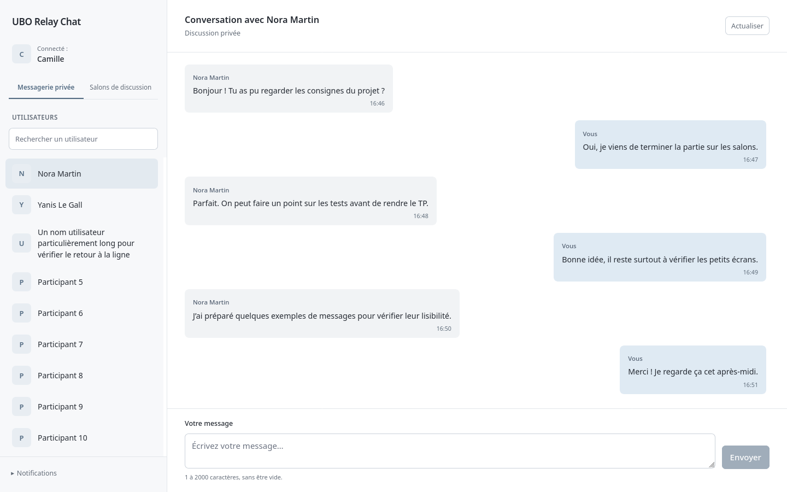
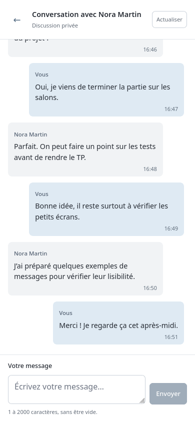

# Étape 11 — Refonte globale de l’interface

## Résultat

Toutes les routes existantes utilisent une même identité visuelle. L’espace authentifié comporte une navigation latérale, un répertoire consultable et un panneau de conversation. Les messages privés et publics partagent les mêmes composants de présentation. Les formulaires publics sont centrés, étiquetés et harmonisés. Aucun endpoint, contrat API, slice, thunk, hook de polling, script Lua ou mécanisme de session n’a été modifié. Aucun fichier d’environnement n’a été modifié et aucun déploiement n’a été effectué.

Les références [Signal](https://knowledge.iadb.org/en/open-knowledge/code-development/open-source-solution/signal), [Element](https://element.io/blog/new-element-web-and-desktop-apps-have-distinct-element-x-vibes/) et [Zulip](https://zulip.com/help/left-sidebar) ont été consultées pour l’organisation liste/conversation et la navigation. Aucun code, logo, image ou élément de marque n’a été repris.

## Design system

Les variables communes sont dans `src/index.css`. Le thème repose sur des surfaces unies et des séparateurs, sans dégradé, ombre, animation, illustration décorative ou dépendance UI.

| Usage | Couleur |
| --- | --- |
| Fond général | `#F7F8FA` |
| Surface | `#FFFFFF` |
| Texte principal | `#252A32` |
| Texte secondaire | `#626B77`, ajusté pour le contraste |
| Accent / bouton principal | `#536B82` |
| Accent au survol | `#40576C` |
| Séparateurs | `#E2E6EA` |
| Message reçu | `#F1F3F5` |
| Message envoyé | `#DFEAF3` |
| Erreur | `#9B3A35` |

Police système sans-serif, corps 15 px, titres courants autour de 16–20 px et titres des formulaires 24 px. Graisses 400, 500 et 600. Espacements principalement par multiples de 8 px et rayons de 7–8 px. Les inputs passent à 16 px sur mobile. Les interactions ont des états hover, disabled et focus visibles. Aucun faux état « en ligne », compteur de messages non lus ou bouton de déconnexion sans implémentation n’a été ajouté. Les initiales affichées proviennent du nom réel fourni au composant.

Les contrastes calculés selon la luminance relative sont de 14,42:1 pour le texte principal sur blanc, 5,40:1 pour le texte secondaire sur blanc, 5,54:1 pour le bouton principal, 11,81:1 pour le texte des messages envoyés et 12,97:1 pour les reçus. Ce contrôle de couleurs n’est pas une certification complète d’accessibilité.

## Architecture commune

```text
App / routes existantes
├── AuthLayout
│   ├── LoginPage → Login
│   ├── RegisterPage
│   └── NotFoundPage
└── ProtectedRoute existante
    └── AppShell
        ├── identité du compte depuis Redux
        ├── navigation privée / salons
        ├── Directory : liste, recherche locale, état actif, erreurs / chargement
        ├── préférences de notifications dans un details natif
        └── contenu de la route
            ├── MessagesPage : sélection d’un utilisateur
            ├── RoomsPage : création d’un salon
            └── PrivateConversation / RoomConversation
                ├── ConversationHeader
                ├── liste existante avec MessageBubble
                └── MessageComposer
```

`AppShell` reçoit le répertoire de chaque page ; il ne déclenche pas de nouvelles requêtes. Les pages conservent leurs hooks existants `useUsers`, `useRooms` et `useMessagePolling`. `Directory` filtre uniquement les données déjà chargées : aucune API de recherche n’est inventée. Le panneau principal revient en haut au changement de chemin ; le scroll interne des messages est toujours géré par les refs et la logique de proximité du bas déjà présentes.

Les composants `ConversationHeader`, `MessageBubble` et `MessageComposer` sont regroupés dans un seul module de présentation. Les callbacks, le contrôle du brouillon, la validation, les signaux d’annulation et l’envoi restent dans les composants de conversation existants. Le panneau Notifications conserve son hook et ses boutons ; seul son emplacement et sa présentation changent.

## Audit CSS et corrections

Les trois CSS existants ont été examinés. `App.css` contenait les styles et l’animation du logo du template React ; ils ont été remplacés par les styles de structure réellement utilisés. `index.css` définissait des hauteurs en pourcentage sans chaîne de hauteur complète ; la nouvelle structure utilise un viewport dynamique et des conteneurs flex/grid avec `min-height: 0` et `min-width: 0`. L’ancien CSS des conversations limitait l’historique à 28 rem et le centrait sans vraie structure de page ; l’historique occupe désormais l’espace disponible au-dessus de l’éditeur.

Les règles communes couvrent la typographie, les champs et les boutons. Les styles de structure sont limités à des classes dédiées ; les styles des messages restent dans `ConversationPage.css`. Les styles d’alerte sont communs, avec des règles locales pour les erreurs de polling et de formulaire. `src/index.jsx`, `src/App.jsx` et les chemins des routes ont été inspectés et conservés.

## Changements par route

| Route / état | Présentation |
| --- | --- |
| `/login` | Zone centrée de largeur limitée, labels visibles, autocomplete conservé, erreurs accessibles sous les champs, bouton principal et lien d’inscription |
| `/register` | Même structure et même rythme ; validations, longueurs, attributs et champs contrôlés conservés |
| `/messages` | Répertoire à gauche avec recherche locale ; instruction de sélection dans le panneau principal sur ordinateur |
| `/messages/user/:userId` | Répertoire actif, en-tête, historique flexible, messages distingués par couleur et alignement, heure discrète, éditeur en bas |
| `/rooms` | Navigation de salons, recherche locale, formulaire de création sobre ; accès direct au formulaire sur mobile |
| `/rooms/:roomId` | Présentation commune à la conversation privée, avec noms des auteurs et indication d’accès public conservés |
| 404 | Identité commune aux pages publiques, message clair et lien de retour fonctionnel |
| Restauration de session | État de chargement centré ; erreur et bouton de nouvelle tentative conservés |
| Notifications | Préférences repliables dans la navigation, sans grande section au-dessus des utilisateurs ; états et diagnostics existants conservés |

## Responsive et accessibilité

Sur ordinateur, la barre latérale mesure 306 px (330 px sur très grand écran) et le panneau principal utilise le reste de la largeur. Les longues listes ont leur propre scroll, tandis que l’éditeur reste dans la hauteur du panneau.

Sous 720 px, les répertoires prennent toute la largeur. À l’ouverture d’une conversation, la barre latérale est masquée et un lien de retour explicite est disponible dans l’en-tête, y compris si la conversation ou le salon est invalide ou introuvable. La liste des salons n’impose plus un écran entier de hauteur avant le formulaire de création. Le lien « Nouveau salon » permet de rejoindre ce formulaire immédiatement. Les notifications restent accessibles depuis les répertoires.

Les liens restent des liens et les actions restent des boutons. Les champs de recherche ont un label accessible ; les champs de connexion ont maintenant des labels explicites. Les états `aria-current`, `aria-invalid`, `aria-describedby`, `aria-busy` et les rôles status/alert sont conservés ou renseignés. Les conversations disposent d’un titre h1. Un lien d’évitement permet d’accéder au contenu depuis le clavier. Le contrôle notifications utilise `details/summary` natif. Aucun changement n’a été apporté au contenu des messages : React continue de l’échapper.

## Fichiers créés et modifiés

Créés :

```text
src/components/
├── AppShell.tsx
├── AuthLayout.tsx
├── ConversationUI.tsx
└── Directory.tsx
scripts/design-browser.mjs
docs/etape-11-design-global.md
docs/assets/etape-11/   (25 captures et mesures.json)
```

Modifiés :

```text
src/index.css
src/App.css
src/pages/ConversationPage.css
src/pages/LoginPage.tsx
src/pages/RegisterPage.tsx
src/pages/MessagesPage.tsx
src/pages/ConversationPage.tsx
src/pages/RoomsPage.tsx
src/pages/RoomPage.tsx
src/pages/NotFoundPage.tsx
src/user/Login.tsx
package.json
package-lock.json
src/routes/ProtectedRoute.tsx
src/features/notifications/NotificationControls.tsx
scripts/auth.test.cjs
```

Dans `scripts/auth.test.cjs`, six sélecteurs ou assertions liés à l’ancien HTML ont été adaptés pour retrouver le formulaire par son type ou comparer le texte sans dépendre des spans. Les assertions de validation, de connexion, de navigation et d’absence de fuite sont conservées ; aucun test n’a été supprimé.

## Captures et examen visuel

Les captures utilisent des comptes et messages de test fournis uniquement par les API simulées du script navigateur. Ces données ne figurent dans aucun écran de l’application de production. Les dimensions sont 1440 × 900 pour ordinateur et 390 × 844 pour mobile, avec un contrôle supplémentaire à 390 × 500. Le fichier [mesures.json](assets/etape-11/mesures.json) conserve les dimensions et les mesures de largeur/défilement de chaque capture.

Aperçu d’une conversation sur ordinateur :



Aperçu de la conversation mobile :



Galerie des principaux parcours :

| Écran | Ordinateur | Mobile |
| --- | --- | --- |
| Connexion | [Capture](assets/etape-11/desktop-login.png) | [Capture](assets/etape-11/mobile-login.png) |
| Inscription | [Capture](assets/etape-11/desktop-register.png) | [Capture](assets/etape-11/mobile-register.png) |
| Erreurs de validation | [Capture](assets/etape-11/desktop-register-errors.png) | [Capture](assets/etape-11/mobile-register-errors.png) |
| Utilisateurs | [Capture](assets/etape-11/desktop-users.png) | [Capture](assets/etape-11/mobile-users.png) |
| Conversation privée | [Capture](assets/etape-11/desktop-private.png) | [Capture](assets/etape-11/mobile-private.png) |
| Salons | [Capture](assets/etape-11/desktop-rooms.png) | [Capture](assets/etape-11/mobile-rooms.png) |
| Groupe | [Capture](assets/etape-11/desktop-group.png) | [Capture](assets/etape-11/mobile-group.png) |
| Notifications | [Capture](assets/etape-11/desktop-notifications.png) | [Capture](assets/etape-11/mobile-notifications.png) |
| 404 | [Capture](assets/etape-11/desktop-404.png) | [Capture](assets/etape-11/mobile-404.png) |

Les captures supplémentaires couvrent les notifications activées, le chargement et l’erreur de liste, l’échec d’envoi avec brouillon conservé, la création de salon sur mobile, un message long et une hauteur de viewport réduite.

Les captures des principaux écrans ont été ouvertes et examinées, pas seulement produites. Défauts corrigés au cours de cet examen :

- Espace vide excessif sous les salons sur mobile : suppression de la hauteur minimale d’un écran pour cette liste et ajout du lien vers la création.
- Création de salon trop éloignée dans la page mobile : liste bornée et accès direct au formulaire, sans nouvelle route.
- Position du panneau principal lors de la navigation : remise en haut au changement de chemin, indépendante du scroll de l’historique.
- Liens violets, formulaires en ligne et labels de connexion absents : styles communs et labels explicites.
- Risque de débordement des noms/messages longs : largeur minimale nulle sur les colonnes, retour à la ligne des textes et listes scrollables.
- Boutons et champs difficiles à repérer au clavier : focus visible contrôlé dans Firefox, navigation Tab entre les champs vérifiée.

## Types React requis pour la compilation

Le contrôle final a révélé que le projet ne disposait pas de `@types/react` et `@types/react-dom`. Sans ces déclarations, TypeScript ne reconnaissait pas correctement `children` et `key` dans les nouveaux composants de présentation typés. Les deux paquets ont été ajoutés en dépendances de développement, avec leur dépendance de types transitive. Il ne s’agit pas d’une bibliothèque UI et aucun code visuel n’est ajouté au bundle. `package.json` et le lockfile sont donc modifiés uniquement pour ces déclarations. Référence : [React — utilisation de TypeScript](https://react.dev/learn/typescript).

## Tests réellement exécutés

| Vérification | Résultat |
| --- | --- |
| `node scripts/auth.test.cjs` | 337 tests réussis, tous les tests actuels conservés |
| `node scripts/vercel-packaging.test.cjs` | 8 tests réussis |
| TypeScript application (`tsconfig.app.json`, noEmit, incremental false) | Réussi |
| TypeScript configuration (`tsconfig.node.json`, mêmes options) | Réussi |
| `node scripts/design-browser.mjs` | Réussi dans Firefox réel, API et SDK Beams simulés |
| `node scripts/notifications-browser.mjs` | Parcours existant réussi après refonte |
| Build Vite sans `.env`, en mémoire | Réussi, 80 modules transformés |
| Build temporaire du parcours notifications | Réussi ; copie du service worker conservée |
| `git diff --check` | Réussi |
| Contrastes de cinq associations de couleurs | Calculés et rapportés plus haut |

Le script design vérifie la protection d’un salon anonyme, le retour mobile depuis une conversation invalide ou un salon inconnu, la connexion, la navigation sans rechargement complet, la validation et création de salon, le conflit de nom, l’envoi privé et de groupe, la conservation du brouillon après erreur, la nouvelle tentative, la restauration après rafraîchissement et les erreurs 401/404. Il vérifie aussi l’échappement HTML, la séparation entre privé et salon et l’arrêt du polling après invalidation de session.

Le polling est exécuté avec l’intervalle de production de 8 secondes accéléré à 250 ms uniquement dans le navigateur de test. Le test vérifie l’absence de requêtes concurrentes, la pause hors ligne ou lorsque la page est masquée, la reprise et les changements rapides de salon. Sur mobile, un nouveau message ne ramène pas au bas de l’historique lorsque l’utilisateur lit plus haut ; lorsqu’il est près du bas, le dernier message reste visible. Le viewport réduit confirme que l’éditeur reste dans la hauteur disponible. Les 25 captures vérifient l’absence de débordement horizontal.

Les tests notifications utilisent exclusivement un faux SDK et des API simulées : activation, désactivation, refus, erreurs et nettoyage ne modifient aucun abonnement réel. Les contrôles de logs/DOM ne montrent pas de token de test. Le build temporaire conserve l’avertissement Vite de taille du chunk principal supérieur à 500 kB ; il ne bloque pas la compilation.

Pour rejouer les contrôles :

```bash
node scripts/auth.test.cjs
node scripts/vercel-packaging.test.cjs
node node_modules/typescript/bin/tsc --project tsconfig.app.json --noEmit --incremental false --pretty false
node node_modules/typescript/bin/tsc --project tsconfig.node.json --noEmit --incremental false --pretty false
node scripts/design-browser.mjs
node scripts/notifications-browser.mjs
git diff --check
```

Les scripts navigateur nécessitent Firefox installé à `/usr/bin/firefox` et l’autorisation d’écouter sur localhost. Ils ferment leurs propres serveurs et profils temporaires. Aucun déploiement n’est lancé.

## Limites restantes

- Les tests visuels utilisent Firefox desktop avec changement de viewport. Aucun téléphone physique ni clavier logiciel réel n’a été utilisé ; le contrôle à hauteur réduite ne prouve pas le comportement de tous les claviers mobiles.
- Les bases et les API des parcours navigateur sont simulées. Cette refonte ne valide pas de nouveaux échanges réels sur Neon/Upstash ni la livraison d’un push système ; elle préserve leur logique existante.
- Aucune nouvelle validation de l’horloge système, de la clé Pusher ou de la réception réelle n’a été faite pendant cette intervention de présentation.
- Les résultats de contraste et les contrôles au clavier ne remplacent pas un audit complet avec lecteur d’écran. Aucun audit automatisé de toutes les règles WCAG n’a été exécuté.
- Aucun indicateur d’en ligne, non-lu, avatar photo ou déconnexion serveur n’a été ajouté. La recherche est locale et ne porte que sur la liste chargée.
- Les choix de découpage des bundles restent ceux du projet. L’avertissement de taille Vite n’a pas déclenché de refactoring global.

Refonte terminée ; aucune autre fonctionnalité n’est commencée.

### Inventaire des captures

- [desktop-404.png](assets/etape-11/desktop-404.png)
- [desktop-group.png](assets/etape-11/desktop-group.png)
- [desktop-loading.png](assets/etape-11/desktop-loading.png)
- [desktop-login.png](assets/etape-11/desktop-login.png)
- [desktop-notifications-active.png](assets/etape-11/desktop-notifications-active.png)
- [desktop-notifications.png](assets/etape-11/desktop-notifications.png)
- [desktop-private.png](assets/etape-11/desktop-private.png)
- [desktop-register-errors.png](assets/etape-11/desktop-register-errors.png)
- [desktop-register.png](assets/etape-11/desktop-register.png)
- [desktop-rooms.png](assets/etape-11/desktop-rooms.png)
- [desktop-send-error.png](assets/etape-11/desktop-send-error.png)
- [desktop-users-error.png](assets/etape-11/desktop-users-error.png)
- [desktop-users.png](assets/etape-11/desktop-users.png)
- [mobile-404.png](assets/etape-11/mobile-404.png)
- [mobile-compact-height.png](assets/etape-11/mobile-compact-height.png)
- [mobile-group.png](assets/etape-11/mobile-group.png)
- [mobile-login.png](assets/etape-11/mobile-login.png)
- [mobile-long-message.png](assets/etape-11/mobile-long-message.png)
- [mobile-notifications.png](assets/etape-11/mobile-notifications.png)
- [mobile-private.png](assets/etape-11/mobile-private.png)
- [mobile-register-errors.png](assets/etape-11/mobile-register-errors.png)
- [mobile-register.png](assets/etape-11/mobile-register.png)
- [mobile-room-create.png](assets/etape-11/mobile-room-create.png)
- [mobile-rooms.png](assets/etape-11/mobile-rooms.png)
- [mobile-users.png](assets/etape-11/mobile-users.png)
